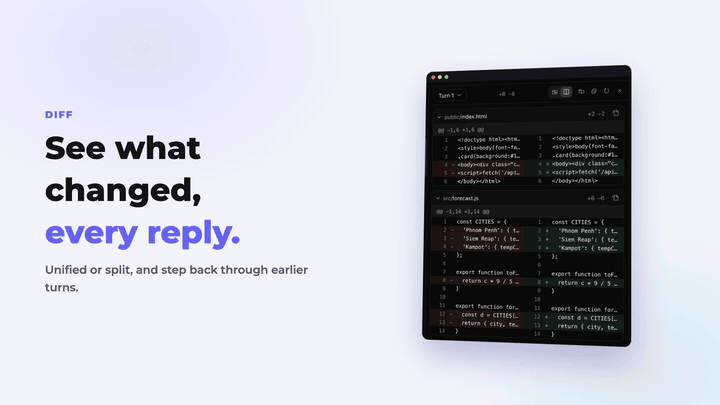
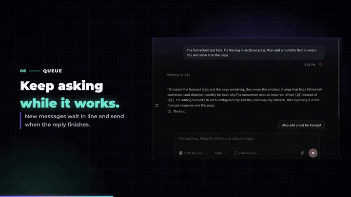
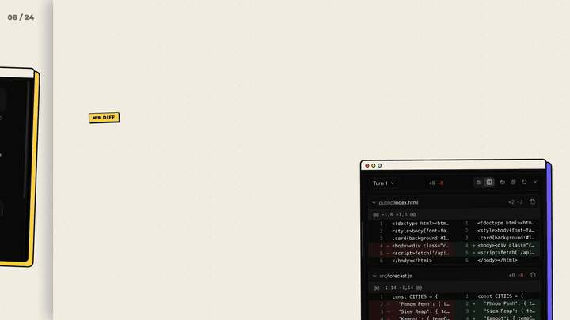

# Edit-ads

Two [Claude Code](https://claude.com/claude-code) skills for making videos about **your own app**, in
**Khmer (ខ្មែរ) and English**. Just ask Claude in plain words. Or run the scripts yourself.

| Skill | What you get |
|---|---|
| [**product-promo-video**](skills/product-promo-video) | A 1:45 product promo video from screenshots: music only, 3 styles (Template, Neon, Paper) |
| [**app-walkthrough-video**](skills/app-walkthrough-video) | A full narrated walkthrough recorded from the real app: voiceover (clone your own voice), chapters, zooms, captions, subtitles, a 9:16 highlight cut, a 5-part series, a 2-minute ad, covers and posts |

## See it

All of these were made with these skills (the app is [GenNal](https://gen-nal.onrender.com/)).
▶️ **Watch or download the full videos:** [Releases → samples](https://github.com/chydevit/Edit-ads/releases/tag/samples)

### product-promo-video

| Template | Neon | Paper |
|---|---|---|
|  |  |  |
|  |  |  |

### app-walkthrough-video

| 16:9 walkthrough | 9:16 highlights | 2-minute ad |
|---|---|---|
|  |  |  |

## Install

```bash
git clone https://github.com/chydevit/Edit-ads.git ~/Edit-ads
bash ~/Edit-ads/install.sh
```

`install.sh` links both skills into `~/.claude/skills/` and installs what they need. You need:
- **Node.js 18+**, **ffmpeg** and **Python 3**
- **Google Chrome** for the website-tour recording
- `bash install.sh --voice` also installs the free local voice model (~7 GB) used for narration and voice cloning.

To update later: `cd ~/Edit-ads && git pull && bash install.sh`.

## Use

Open Claude Code and ask, for example:

> Make a product video for my app from the screenshots in ~/shots, Neon style, Khmer and English

> Make a full walkthrough video of my app at ~/code/my-app showing every feature, English voice with Khmer and Chinese subtitles, then cut it into 5 parts and make covers

> ធ្វើវីដេអូបង្ហាញរបៀបប្រើ app របស់ខ្ញុំ ជាភាសាខ្មែរ ប្រើសំឡេងរបស់ខ្ញុំ

Step-by-step guides (English + ខ្មែរ) for using the scripts by hand:
- [product-promo-video/README.md](skills/product-promo-video/README.md)
- [app-walkthrough-video/README.md](skills/app-walkthrough-video/README.md)

## Licenses

- Code: MIT.
- Fonts: Kantumruy Pro, Noto Sans Khmer and Montserrat, under the SIL Open Font License 1.1.
- Music and sound effects are generated by the included scripts. They are original, with no samples.
- Example screenshots, logo and sample videos © GenNal. They're for trying the skills only.
