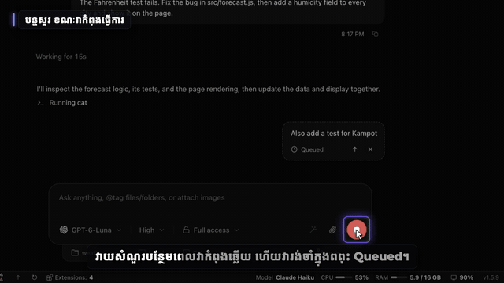
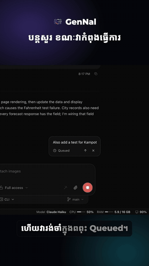
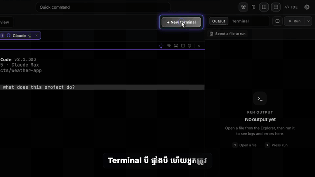

# app-walkthrough-video

This skill makes a **full narrated walkthrough video of a real app**. It records the real app, then
edits the film automatically:
- **Picture:** zooms on every click, a cursor, labels, chapter cards and animated captions.
- **Sound:** voiceover in a designed voice or **your own cloned voice** (Khmer works), plus music and sound effects, normalized to −14 LUFS.
- **Subtitle tracks:** one per language (e.g. English, ខ្មែរ, 中文).

The same recordings also give you:
- a 9:16 highlight cut
- an N-part series
- a 2-minute ad
- a thumbnail and covers
- a script, a shot list, a YouTube description with chapters, and ready-to-paste posts

| 16:9 walkthrough | 9:16 highlights | 2-minute ad |
|---|---|---|
|  |  |  |

▶️ Full sample videos: [Releases → samples](https://github.com/chydevit/Edit-ads/releases/tag/samples)

---

## Contents

1. [What you need](#1-what-you-need)
2. [Install](#2-install)
3. [Make a video with Claude](#3-make-a-video-with-claude)
4. [How it works, step by step](#4-how-it-works-step-by-step)
5. [Commands](#5-commands)
6. [Tips](#6-tips)
7. [Troubleshooting](#7-troubleshooting)
8. [របៀបប្រើ (ភាសាខ្មែរ)](#8-របៀបប្រើ-ភាសាខ្មែរ)

## 1. What you need

- macOS (best tested) or Linux
- **Node.js 18+**, **ffmpeg**, **Python 3**
- **Google Chrome**, only for recording a website tour
- The app you want to film: an **Electron desktop app** or a **web app**
- Optional: about 7 GB of disk for the free local voice model (VoxCPM2)

## 2. Install

```bash
git clone https://github.com/chydevit/Edit-ads.git ~/Edit-ads
bash ~/Edit-ads/install.sh --voice      # leave out --voice if you will record your own narration
```

## 3. Make a video with Claude

Open Claude Code in your app's folder and ask, e.g.:

> Make a full walkthrough video of this app showing every feature. English voice, Khmer and Chinese subtitles. Also make a 9:16 highlight cut and a 2-minute ad.

> ធ្វើវីដេអូបង្ហាញគ្រប់មុខងាររបស់ app នេះ ជាភាសាខ្មែរ ប្រើសំឡេងរបស់ខ្ញុំ (voice/km_ref.wav)

Claude will:
1. **Plan** the chapters and script with you.
2. **Prepare a demo environment**, so none of your private data appears on screen.
3. **Write and record the scenes** on the real app.
4. **Translate the script and generate the voice.**
5. **Edit, render and check** every output.

Afterwards you can ask:
- "cut it into 5 parts"
- "make covers"
- "make posts"
- "make the Khmer version"

Long steps run in the background. Recording with AI agents inside the app, voice generation and the
final render each take a while, so ask "what's the status?" any time.

## 4. How it works, step by step

Everything for one film lives in a project folder. Copy the example to start:

```bash
S=~/.claude/skills/app-walkthrough-video
cp -R $S/examples/gennal-walkthrough ~/my-film
```

| Step | You edit | Command | Result |
|---|---|---|---|
| 1. Plan | `script/beats.json` (chapters → beats: one voice line + one shot each) | | |
| 2. Configure | `project.json` (app path, window, privacy filters, brand, voices, languages) | | |
| 3. Record | `rec/scenes.mjs` (one function per take) | `bash $S/scripts/rec.sh ~/my-film scenes c01,c02 --launch` | `clips/<scene>/clip.mp4` + `events.json` |
| 3b. Website | `project.json` → `site` | `bash $S/scripts/rec.sh ~/my-film site` | `clips/site-tour` … |
| 4. Translate | `script/translations.json`, `script/ui_km.json` | | |
| 5. Voice | `project.json` → `voice` (+ `voice/km_ref.wav` to clone your voice) | `bash $S/scripts/voice.sh ~/my-film km` | `tts/km/*.wav` |
| 6. Check voice | | `python3 $S/scripts/qc_voice.py ~/my-film km` | lines to regenerate |
| 7. Edit | | `bash $S/scripts/make.sh ~/my-film km` | timeline, SRTs, captions, ad, docs |
| 8. Render | | `bash $S/scripts/finish.sh ~/my-film km` | `out/*-16x9.mp4`, `*-9x16.mp4`, `*-ad-16x9.mp4` |
| 9. Series | | `python3 $S/scripts/split_parts.py ~/my-film km 5` | `out/parts/*` |
| 10. Covers | `project.json` → `covers` | `python3 $S/scripts/covers.py ~/my-film km` | `out/covers/*.png` |

Full reference:
- [references/project.md](references/project.md): project folder, `beats.json` and `project.json`
- [references/recording.md](references/recording.md): demo environment, writing scenes, privacy
- [references/voice.md](references/voice.md): designed or cloned voices, Khmer pronunciation, voice check
- [references/editing.md](references/editing.md): the edit, deliverables, QC checklist

### A recorded scene looks like this

```js
const { Scene, runScenes } = await import(process.env.WALK_HARNESS);
await runScenes({
  async c05(page) {
    const s = new Scene(page, 'c05'); await s.start();
    s.shot('agents-send');                                  // beats.json: "shot": "agents-send"
    await s.click(page.getByRole('button', { name: 'New thread' }), 'New thread');
    await s.type('Fix the failing test in src/forecast.js');
    await s.key('Enter', 1500);
    s.shot('agents-live');
    s.speedFrom(); await page.waitForTimeout(40000); s.speedTo();   // shown fast-forwarded
    await s.stop();
  },
});
```

Each `click` and `box` mark becomes a smooth zoom, a highlight and a cursor in the final video. Each `shot`
is the footage a voice line plays over.

## 5. Commands

```text
scripts/setup.sh [--voice]                  install (once)
scripts/rec.sh <project> launch             open the app fresh on the demo profile
scripts/rec.sh <project> poke '<js>' [png]  try selectors on the running app
scripts/rec.sh <project> scenes a,b [--launch]  record takes
scripts/rec.sh <project> site               record the website tour
scripts/rec.sh <project> sheet              contact sheet of every take's last frame
scripts/voice.sh <project> <lang> [--ad]    generate voice lines (skips existing)
scripts/qc_voice.py <project> <lang>        find bad voice lines
scripts/phonetic.py <project> km            English words the Khmer voice still has to guess
scripts/make.sh <project> <lang> [--render] timeline + subtitles + captions + ad + docs
scripts/finish.sh <project> <lang> [walkthrough|vertical|ad|all]   render + master
scripts/split_parts.py <project> <lang> [N] series with title cards and per-part subtitles
scripts/covers.py <project> <lang>          thumbnail, 9:16 cover, part covers
```

## 6. Tips

- **Privacy first:**
  - Record in a demo HOME with sample projects, never your real account.
  - Add your name, computer name and handles to `redact` in `project.json` (emails are always blurred), and QR codes to `redact_css`.
  - Still check every take.
- **One idea per beat:** 1–3 sentences per voice line. 60–80 beats ≈ 13–15 minutes.
- **Record the real thing working.** If a feature is broken, fix it or leave it out.
- **Your own voice:** record 10–20 seconds of clean speech (quiet room, no music) as `voice/km_ref.wav`, and type exactly what you said into `voice.km.ref_text`.
- **Footage you film yourself** (installers, phone screens) goes in `script/slots.json`. It shows as a placeholder until you replace it.
- **Re-run `make.sh`** after any change to the script, voice or recordings.

## 7. Troubleshooting

| Problem | Fix |
|---|---|
| The app opens then closes at once | `ELECTRON_RUN_AS_NODE` is set in your shell; `rec.sh` unsets it, so launch through `rec.sh` |
| `no page matching app://` | Set `app.page_match` to the start of your app's page URL (`rec.sh <p> poke 'return page.url()'`) |
| Port already in use | Change `app.cdp_port` / `app.inspect_port` (Chrome often uses 9222) |
| Zooms land in the wrong place | The app has its own zoom: reset it with `app.on_connect` (e.g. `await window.api.zoom.set(1)`) |
| A word sounds wrong in Khmer | Add it to `script/lexicon_km.json`, delete that line's wav, run `voice.sh` again |
| Captions show as grey boxes | Don't use CSS `background-clip:text` in the template; it breaks in renders |
| A shot is `MISSING` | No scene marks that shot id. Record it, or point the beat at another shot |

---

## 8. របៀបប្រើ (ភាសាខ្មែរ)

**វាធ្វើអ្វីខ្លះ៖**
- ថតវីដេអូពី app ពិតរបស់អ្នក ហើយកាត់តដោយស្វ័យប្រវត្តិ៖ zoom ពេលចុច, cursor, ស្លាក, ជំពូក និង caption មានចលនា។
- សំឡេងអាន (អាចប្រើសំឡេងរបស់អ្នកផ្ទាល់ជាភាសាខ្មែរ)។
- Subtitle ច្រើនភាសា។
- វីដេអូ 9:16 សម្រាប់ TikTok, វីដេអូជាភាគៗ, ពាណិជ្ជកម្ម ២ នាទី, រូប cover និងអត្ថបទសម្រាប់ post។

**ដំឡើង៖**

```bash
git clone https://github.com/chydevit/Edit-ads.git ~/Edit-ads
bash ~/Edit-ads/install.sh --voice
```

**ប្រើជាមួយ Claude៖** បើក Claude Code ក្នុង folder របស់ app ហើយសរសេរ ឧទាហរណ៍៖

> ធ្វើវីដេអូបង្ហាញគ្រប់មុខងាររបស់ app នេះ ជាភាសាខ្មែរ ប្រើសំឡេងរបស់ខ្ញុំ ហើយកាត់ជា ៥ ភាគ

**ប្រើសំឡេងរបស់អ្នក៖**
1. ថតសំឡេងខ្លួនឯង ១០–២០ វិនាទី នៅកន្លែងស្ងាត់ គ្មានតន្ត្រី។
2. រក្សាទុកជា `voice/km_ref.wav`។
3. សរសេរពាក្យដែលអ្នកនិយាយ ឱ្យដូចបេះបិទ ក្នុង `project.json` → `voice.km.ref_text`។

**ជំហានដោយខ្លួនឯង៖**
1. `cp -R $S/examples/gennal-walkthrough ~/my-film`, ហើយកែ `project.json` និង `script/beats.json`។
2. ថត៖ `bash $S/scripts/rec.sh ~/my-film scenes c01 --launch`
3. សំឡេង៖ `bash $S/scripts/voice.sh ~/my-film km`
4. កាត់ត៖ `bash $S/scripts/make.sh ~/my-film km`
5. Render៖ `bash $S/scripts/finish.sh ~/my-film km`
6. ចែកជាភាគ៖ `python3 $S/scripts/split_parts.py ~/my-film km 5`
7. Cover៖ `python3 $S/scripts/covers.py ~/my-film km`

**ឯកជនភាព៖**
- ប្រើ demo profile និងគម្រោងសាកល្បងជានិច្ច។
- ដាក់ឈ្មោះ និងគណនីរបស់អ្នកក្នុង `redact` ដើម្បីឱ្យវាព្រិល។
- ពិនិត្យរាល់វីដេអូមុនពេល post។

**ពាក្យអង់គ្លេសដែលអានខុស៖** បន្ថែមវាក្នុង `script/lexicon_km.json` (សរសេរជាអក្សរខ្មែរតាមសំឡេង) ហើយលុបឯកសារ wav នៃបន្ទាត់នោះ ហើយ run `voice.sh` ម្តងទៀត។
