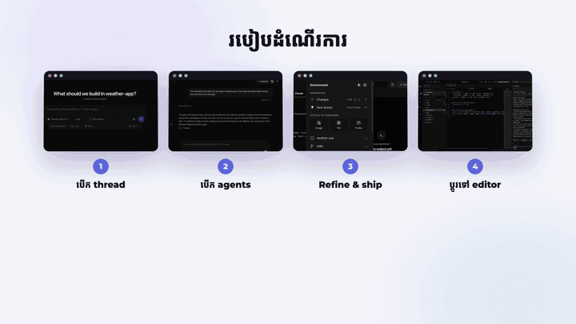
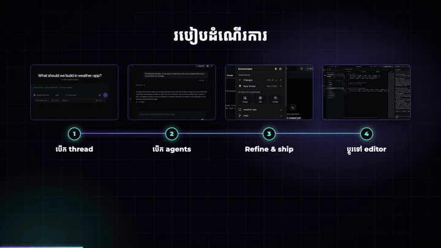
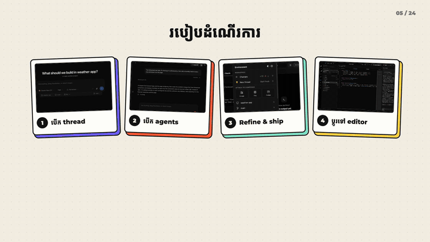
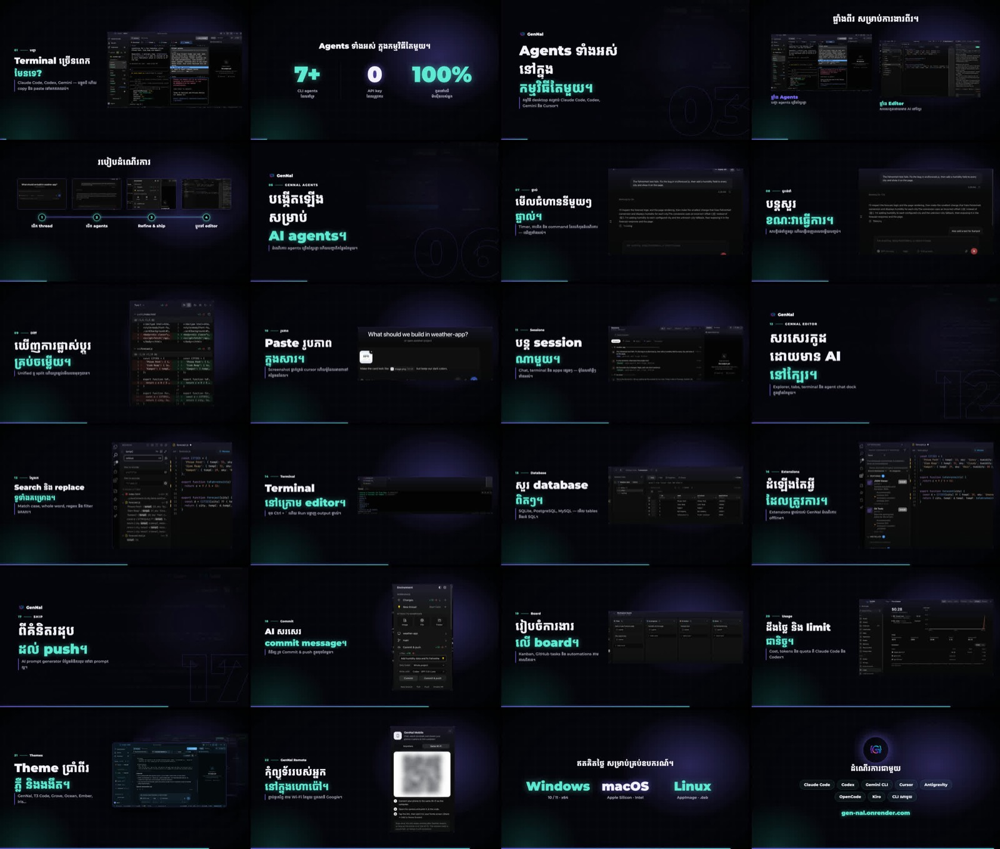
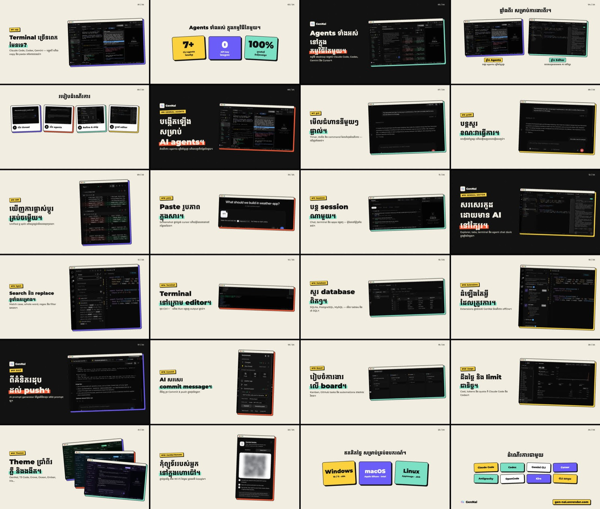
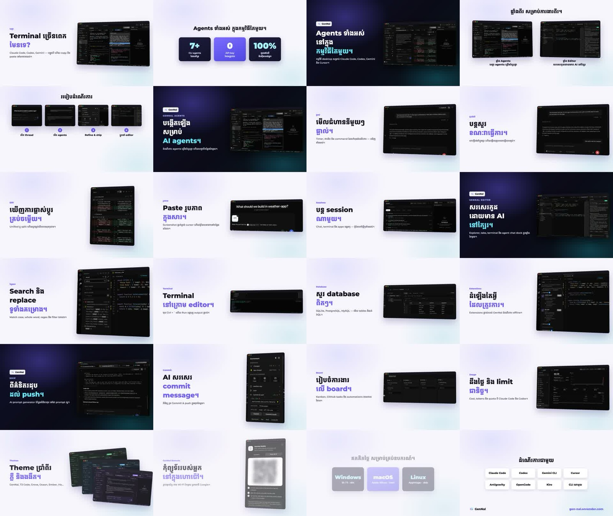

# product-promo-video

A [Claude Code](https://claude.com/claude-code) skill that turns screenshots of your app into a polished
**16:9 product promo video** (1920×1080, music only, about 1:45). It makes them in **Khmer (ខ្មែរ) and English**,
in three styles:

| Style | Look |
|---|---|
| **Template** | light and dark slides that alternate, floating 3D screenshots, stat cards, numbered steps |
| **Neon** | dark and glowing, fast light-streak cuts, headlines revealed by masks, giant chapter numbers |
| **Paper** | warm magazine look, thick outlines, colored hard shadows, highlighter, page-push transitions |

| Template | Neon | Paper |
|---|---|---|
|  |  |  |

Every slide, in each style:

**Neon**


**Paper**


**Template**


▶️ Full videos: [Releases → samples](https://github.com/chydevit/Edit-ads/releases/tag/samples)

---

## Contents

1. [What you need](#1-what-you-need)
2. [Install](#2-install)
3. [Quick test with the example](#3-quick-test-with-the-example)
4. [Make a video for your own app (with Claude)](#4-make-a-video-for-your-own-app-with-claude)
5. [Make a video by hand (without Claude)](#5-make-a-video-by-hand-without-claude)
6. [The slides file](#6-the-slides-file)
7. [Change colors, music and length](#7-change-colors-music-and-length)
8. [Troubleshooting](#8-troubleshooting)
9. [របៀបប្រើ (ភាសាខ្មែរ)](#9-របៀបប្រើ-ភាសាខ្មែរ)

---

## 1. What you need

- **macOS, Linux or Windows (WSL)**
- **Node.js 18 or newer**: `node -v`
- **ffmpeg**: `ffmpeg -version` (macOS: `brew install ffmpeg`; Ubuntu: `sudo apt install ffmpeg`)
- **Python 3**: used for the storyboard. `numpy` is needed only if you want to generate new music.
- **Claude Code** (optional): lets you make videos just by asking.

## 2. Install

Clone the repo, then run the installer once. It links the skills into Claude Code (`~/.claude/skills/`) and installs what they need:

```bash
git clone https://github.com/chydevit/Edit-ads.git ~/Edit-ads
bash ~/Edit-ads/install.sh
```

Setup installs the video renderer (Remotion) and prints `product-promo-video: ready`.
The first render also downloads a small headless Chrome (~170 MB), once.

> If you don't use Claude Code, run `bash ~/Edit-ads/skills/product-promo-video/scripts/setup.sh` instead. The scripts work the same way.

## 3. Quick test with the example

The repo includes a full 24-slide example (GenNal, Khmer and English). Render it to check that everything works:

```bash
S=~/.claude/skills/product-promo-video
bash $S/scripts/render.sh $S/examples/gennal Neon slides_km.json ~/Desktop/test-neon-km.mp4
```

After 2–4 minutes you get:

- `~/Desktop/test-neon-km.mp4`: the video
- `~/Desktop/test-neon-km-storyboard.jpg`: one frame from every slide, for a quick check

Try `Template` or `Paper` in place of `Neon`, and `slides_en.json` for English.

## 4. Make a video for your own app (with Claude)

1. Take screenshots of your app (see the [tips](#screenshot-tips)) and put them in a folder, e.g. `~/my-app-shots/`.
2. Open Claude Code and ask in plain words, for example:

   > Make a product video for my app "TodoMax" from the screenshots in ~/my-app-shots. Khmer and English, Neon style. Website: todomax.app

   > ធ្វើវីដេអូផ្សព្វផ្សាយ app របស់ខ្ញុំ ពីរូបភាពក្នុង ~/my-app-shots ជាភាសាខ្មែរ ស្ទីល Paper

3. Claude will:
   - write the slides (headlines, captions, crops) in each language
   - check the layout with quick stills
   - render the videos, then check the storyboards
   - tell you where the files are

4. Ask for changes the same way, e.g. "make slide 5 say …", "use the Template style too", "make it 60 seconds".

To make a video in the style of an existing one, give Claude the video file: "make it like this video: ~/Downloads/reference.mp4".

## 5. Make a video by hand (without Claude)

### Step 1: Create a project folder

Copying the example is the easiest start:

```bash
S=~/.claude/skills/product-promo-video
cp -R $S/examples/gennal ~/my-film
```

A project folder looks like this:

```
my-film/
  slides_km.json      ← Khmer text and slides
  slides_en.json      ← English text and slides
  logo.png            ← your logo (square, transparent, about 256×256)
  shots/              ← your screenshots (PNG, all the same size)
    home.png
    editor.png
  music/              ← optional, your own music
```

### Step 2: Add screenshots

- Delete the example images in `shots/` and add yours.
- Every screenshot must be **the same size**, e.g. 2880×1620. Put that size in `"shot": {"w": 2880, "h": 1620}`.
- The file name is the image name in the slides file: `shots/editor.png` → `"src": "editor"`.

### Step 3: Edit the slides

Open `slides_en.json` and change the brand, the text and the images (see [section 6](#6-the-slides-file)).
Then do the same in `slides_km.json` in Khmer. Keep the same slides in the same order.

### Step 4: Check the layout quickly (~1 minute)

```bash
bash $S/scripts/stills.sh ~/my-film Neon slides_en.json ~/my-film/check.jpg
```

Open `check.jpg`. Every slide is shown. Fix anything that looks wrong: text too small, a crop that shows the wrong part.
To check only some slides, add their numbers (counted from 0): `... check.jpg 0,4,9`

### Step 5: Render

```bash
bash $S/scripts/render.sh ~/my-film Neon    slides_en.json ~/my-film/out/my-film-neon-en.mp4
bash $S/scripts/render.sh ~/my-film Paper   slides_km.json ~/my-film/out/my-film-paper-km.mp4
bash $S/scripts/render.sh ~/my-film Template slides_km.json ~/my-film/out/my-film-template-km.mp4
```

Each video is normalized to −14 LUFS, the standard loudness for YouTube, Facebook and TikTok. A `-storyboard.jpg` is saved next to it.
Always look at the storyboard before you post.

### Screenshot tips

- Use **demo data**, never your real account. Before you post, check the images for emails, tokens, API keys, file paths with your name, IP addresses and QR codes. Crop or blur them.
- Capture at **2× resolution** (e.g. a 1440×810 window on a Retina screen gives 2880×1620), so close-up crops stay sharp.
- Use one screenshot per feature, showing that feature doing its job, e.g. the diff open or the dialog visible.

## 6. The slides file

```json
{
  "brand": {"name": "TodoMax", "logo": "logo.png"},
  "shot":  {"w": 2880, "h": 1620},
  "slides": [
    {"kind": "hero", "kicker": "PROBLEM", "head": "Too many\nto-do apps?", "accent": "to-do apps?",
     "sub": "Notes here, tasks there, reminders somewhere else.", "img": {"src": "home"}, "dur": 138},

    {"kind": "stats", "head": "Everything in one place.",
     "cards": [{"big": "3x", "small": "faster\nplanning"}, {"big": "0", "small": "ads"}, {"big": "100%", "small": "offline"}], "dur": 138},

    {"kind": "hero", "kicker": "FOCUS", "head": "One list\nfor today.", "accent": "for today.",
     "sub": "Pick three tasks, hide the rest.", "img": {"src": "today", "crop": [600, 200, 1600, 1000]}, "dur": 138},

    {"kind": "end", "head": "Works with", "tiles": ["Google", "Outlook", "Slack", "Notion"], "footer": "todomax.app", "dur": 200}
  ]
}
```

| Field | What it does |
|---|---|
| `kind` | slide layout: `hero`, `dark`, `stats`, `two`, `steps`, `fan`, `end` |
| `kicker` | small label above the headline |
| `head` | big headline. Use `\n` for a new line. Keep it to 2–3 short lines |
| `accent` | the line to color. It must match one line of `head` exactly |
| `sub` | one short sentence under the headline |
| `img.src` | screenshot name in `shots/` (no `.png`) |
| `img.crop` | `[x, y, width, height]` in screenshot pixels: zoom in on one part |
| `dur` | length in frames (30 = 1 second). 138 ≈ 4.6 s |

| `kind` | Use it for |
|---|---|
| `hero` | one feature: text left, screenshot right (most slides) |
| `dark` | the start of a new section (dark slide with your logo) |
| `stats` | 3 big numbers or words (`cards`) |
| `two` | 2 screenshots side by side (`imgs` with `cap`) |
| `steps` | 4 "how it works" steps (`imgs` with short `cap`) |
| `fan` | 3 stacked screenshots, e.g. themes or variants |
| `end` | the last slide: logo grid (`tiles`) and your website (`footer`) |

Full details: [references/slides.md](references/slides.md).

**Crops matter the most.** A whole screenshot is too small to read in a video. Crop to the part the
headline talks about (one panel, one dialog, one button). To find the numbers, open the image in any
image viewer and read the pixel coordinates of the box you want.

## 7. Change colors, music and length

- **Colors:** each style's colors are at the top of its file:
  `template/src/Product.tsx` (`VIOLET`, `CYAN`, `INK`) and `template/src/Styles.tsx` (`N` for Neon, `P` for Paper).
- **Music:**
  - Built in: `music/upbeat.m4a` (used by Template and Neon) and `music/calm.m4a` (used by Paper).
  - Your own: put the file in `my-film/music/` and set `"music": "music/yourfile.mp3"` in the slides file.
  - Silent: set `"music": ""`.
  - New original music of the right length: `python3 $S/scripts/music.py -o ~/my-film/music/bed.wav --dur 110 --mood hype`
- **Length:** change `dur` on each slide, or add and remove slides. Video length ≈ the sum of all `dur` values ÷ 30 seconds.
- **Preview while editing:** `bash $S/scripts/studio.sh ~/my-film` opens a live preview in your browser.
  Pick a style and set the props to `{"file":"slides_en.json"}`. Run it again after you edit the slides.

## 8. Troubleshooting

| Problem | Fix |
|---|---|
| `Node.js 18+ is required` / `ffmpeg is required` | Install them (see [section 1](#1-what-you-need)) and run `setup.sh` again |
| A white or missing screenshot | The `src` name doesn't match a file in `shots/`, or the file isn't a `.png` |
| A crop shows the wrong area | The `crop` numbers are in the screenshot's real pixels, so check `shot.w/h` |
| Headline text is very small | The line is too long. Split it into two lines with `\n` |
| Accent line isn't colored | `accent` must be exactly the same as one line of `head` |
| No sound | `"music": ""` turns music off; check that the path exists in your project |
| Khmer looks broken | Use Unicode Khmer text. The Kantumruy Pro font is bundled |

---

## 9. របៀបប្រើ (ភាសាខ្មែរ)

**អ្វីដែលត្រូវការ៖** Node.js 18+, ffmpeg, Python 3 (និង Claude Code បើចង់ប្រើដោយសួរ)។

**ដំឡើង (ម្តងប៉ុណ្ណោះ)៖**

```bash
git clone https://github.com/chydevit/Edit-ads.git ~/Edit-ads
bash ~/Edit-ads/install.sh
```

**សាកល្បងជាមួយឧទាហរណ៍៖**

```bash
S=~/.claude/skills/product-promo-video
bash $S/scripts/render.sh $S/examples/gennal Neon slides_km.json ~/Desktop/test.mp4
```

**ធ្វើវីដេអូសម្រាប់ app របស់អ្នក ជាមួយ Claude៖**

1. ថតរូបអេក្រង់ app របស់អ្នក (ប្រើទិន្នន័យសាកល្បង កុំឱ្យឃើញ email, token ឬ password)។
2. ដាក់រូបទាំងអស់ក្នុង folder មួយ។
3. បើក Claude Code ហើយសរសេរ ឧទាហរណ៍៖
   > ធ្វើវីដេអូផ្សព្វផ្សាយ app "TodoMax" ពីរូបភាពក្នុង ~/my-app-shots ជាភាសាខ្មែរ និងអង់គ្លេស ស្ទីល Neon
4. Claude នឹងសរសេរ slides ពិនិត្យ layout render វីដេអូ ហើយប្រាប់អ្នកថាឯកសារនៅឯណា។

**ធ្វើដោយខ្លួនឯង៖**

1. Copy ឧទាហរណ៍៖ `cp -R $S/examples/gennal ~/my-film`
2. ដាក់រូបរបស់អ្នកក្នុង `~/my-film/shots/` (ទំហំដូចគ្នាទាំងអស់) និង logo ជា `logo.png`។
3. កែអក្សរក្នុង `slides_km.json` និង `slides_en.json`៖
   - `head` គឺចំណងជើង (ប្រើ `\n` ដើម្បីចុះបន្ទាត់)
   - `accent` គឺបន្ទាត់ដែលមានពណ៌ (ត្រូវដូចបន្ទាត់មួយក្នុង `head` ទាំងស្រុង)
   - `sub` គឺប្រយោគខ្លីខាងក្រោម
   - `img.src` គឺឈ្មោះរូបភាព
   - `img.crop` កាត់យកតែផ្នែកសំខាន់
4. ពិនិត្យ layout លឿនៗ៖ `bash $S/scripts/stills.sh ~/my-film Neon slides_km.json ~/my-film/check.jpg`
5. Render៖ `bash $S/scripts/render.sh ~/my-film Neon slides_km.json ~/my-film/out/video.mp4`
6. មើល `-storyboard.jpg` មុនពេល post។

**ស្ទីល៖** `Template` (ភ្លឺ និងងងឹតឆ្លាស់គ្នា), `Neon` (ងងឹត ភ្លឺចែងចាំង លឿន), `Paper` (ក្រដាស ស៊ុមខ្មៅ ស្រមោលពណ៌)។

**គន្លឹះ៖** ចំណងជើងនីមួយៗ ២–៣ បន្ទាត់ខ្លីៗ។ រក្សាពាក្យបច្ចេកទេសជាភាសាអង់គ្លេស (commit, diff…)។ បញ្ចប់ប្រយោគដោយ `។`។

---

## What's inside

```
SKILL.md               instructions Claude follows
scripts/setup.sh       one-time install
scripts/stills.sh      quick layout check (one still per slide)
scripts/render.sh      render, normalize to −14 LUFS, write storyboard
scripts/studio.sh      live preview in the browser
scripts/storyboard.py  contact sheet of the rendered video
scripts/music.py       generate original music (needs numpy)
scripts/sfx.py         generate the sound effects (needs numpy)
template/              the Remotion video project (all three styles)
examples/gennal/       complete example: 24 slides, Khmer + English
references/slides.md   full slide reference
```

## Licenses

- Code: MIT (see `LICENSE`).
- Fonts: Kantumruy Pro and Montserrat, under the SIL Open Font License 1.1.
- Music and sound effects are generated by `scripts/music.py` and `scripts/sfx.py`. They are original, with no samples.
- Example screenshots and logo © GenNal. They're included only so you can try the skill.
